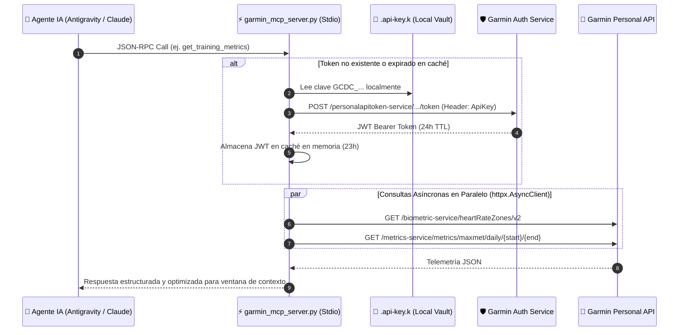

<div align="center">

# ⌚⚡ Garmin Connect Personal MCP Server

** Telemetría deportiva en tiempo real para Agentes de IA mediante el Model Context Protocol (MCP) **

[](https://www.python.org/)
[](https://modelcontextprotocol.io/)
[](https://connect.garmin.com/)
[](https://www.python-httpx.org/)
[](https://connect.garmin.com/)
[](https://connect.garmin.com/)
[](./LICENSE)

*Transformando datos biométricos crudos en inteligencia accionable: este servidor MCP conecta agentes de IA directamente con la API oficial **Garmin Connect Personal** (`personal.connectapi.garmin.com`) sin scraping, sin exponer contraseñas y con latencia mínima.*

---

[Arquitectura](#-arquitectura-e-ingeniería) •
[Dashboard Biométrico Real](#-telemetría-real-y-estado-físico) •
[Catálogo de Herramientas MCP](#-catálogo-de-herramientas-mcp-tools) •
[Instalación y Configuración](#-instalación-y-despliegue) •
[Casos de Uso con IA](#-prompts-y-análisis-inteligente)

</div>

---

## 🧠 El Problema y la Solución

La mayoría de las integraciones con Garmin Connect dependen de librerías no oficiales que simulan inicios de sesión web (*screen scraping*), rompiéndose con frecuencia ante bloqueos de Cloudflare o MFA.

**`garmin-mcp`** adopta un enfoque de ingeniería limpia sobre la **API oficial Garmin Connect Personal**:
1. **Zero-Trust Key Isolation**: Lee una clave personal autogenerada (`GCDC_...`) desde un archivo local aislado (`.api-key.k`), fuera del control de versiones y **nunca expuesta en el contexto del LLM**.
2. **Intercambio OAuth2/JWT con Caché en Memoria**: Negocia automáticamente un *Bearer Token* temporal firmado por `diauth.garmin.com` y lo mantiene en caché durante su ciclo de vida, renovándolo de forma transparente ante respuestas `401 Unauthorized`.
3. **Concurrencia Asíncrona (`asyncio.gather` + `httpx`)**: Agrega en paralelo múltiples microservicios de Garmin (`activity-service`, `biometric-service`, `metrics-service`, `sleep-service`, `hrv-service`, `wellness-service`) en una sola llamada de herramienta.

---

## 🏗️ Arquitectura e Ingeniería



---

## 📊 Telemetría Real y Estado Físico

Datos reales extraídos en vivo por este servidor MCP desde mi cuenta de **Garmin Connect** sobre un bloque de **50 sesiones de entrenamiento**:

### 🫀 Perfil Fisiológico Actual

| Indicador Biométrico | Valor Actual | Referencia / Configuración |
| :--- | :---: | :--- |
| **VO₂ Máximo Estimado** | **`41.0 mL/kg/min`** | Precisión registrada: `40.7 mL/kg/min` |
| **Frecuencia Cardíaca en Reposo (RHR)** | **`53 ppm`** | Base cardiovascular en reposo |
| **Frecuencia Cardíaca Máxima Configurada** | **`195 ppm`** | Pico real registrado en piscina: **`207 ppm`** |
| **Volumen Total (Últimas 50 sesiones)** | **`103.60 km`** | **`36.96 horas`** de actividad · **`24,216 kcal`** |

### 🔥 Configuración de Zonas de Frecuencia Cardíaca (`heartRateZones/v2`)

```text
Zona 1 │ Calentamiento     │  98 – 116 ppm  ░░░▒▒▒▒▒▒▒▒▒▒▒▒▒▒▒▒▒  50% - 60% FC Máx
Zona 2 │ Base Aeróbica     │ 117 – 136 ppm  ░░░░░░▒▒▒▒▒▒▒▒▒▒▒▒▒▒  60% - 70% FC Máx
Zona 3 │ Aeróbico          │ 137 – 155 ppm  ░░░░░░░░░░▒▒▒▒▒▒▒▒▒▒  70% - 80% FC Máx  ◄ Zona media habitual en nado (155 ppm)
Zona 4 │ Umbral Anaeróbico │ 156 – 175 ppm  ░░░░░░░░░░░░░░▒▒▒▒▒▒  80% - 90% FC Máx
Zona 5 │ Esfuerzo Máximo   │ 176 – 195+ ppm ░░░░░░░░░░░░░░░░░███  90% - 100% FC Máx
```

### 🏅 Desglose por Disciplina (Últimas 50 Actividades)

| Disciplina | Sesiones | Distancia Acumulada | Tiempo Activo | Calorías | FC Media | FC Máx Registrada |
| :--- | :---: | :---: | :---: | :---: | :---: | :---: |
| 🏊‍♂️ **Natación en Piscina** (`lap_swimming`) | **30** | **67.62 km** | **26 h 07 min** | **18,673 kcal** | 155 ppm | **207 ppm** |
| 🏋️‍♂️ **Funcional & Multideporte** (`Clase J*3` / otros) | **10** | **15.37 km** | **5 h 22 min** | **2,201 kcal** | 113 ppm | 176 ppm |
| ⚡ **HIIT & Fuerza** (`hiit` + `strength_training`) | **6** | — | **2 h 16 min** | **1,483 kcal** | 135 ppm | **184 ppm** |
| 🏃‍♂️ **Running & Cinta** (`running` + `treadmill`) | **3** | **16.24 km** | **2 h 00 min** | **1,455 kcal** | 156 ppm | **179 ppm** |
| 🥾 **Trekking / Caminata** (`Punilla Caminar`) | **1** | **4.37 km** | **1 h 12 min** | **404 kcal** | 109 ppm | 158 ppm |
| **TOTALES** | **50** | **103.60 km** | **36 h 57 min** | **24,216 kcal** | **144 ppm** | **207 ppm** |

### ⏱️ Muestra de Sesiones Recientes Consultadas vía MCP

| Fecha | Actividad | Distancia | Duración | Ritmo / Intensidad | FC Media / Máx | Energía |
| :---: | :--- | :---: | :---: | :---: | :---: | :---: |
| `08 Nov` | 🥾 **Punilla Caminar** | `4,374 m` | `72.3 min` | Zona 1-2 Recuperación | `109 / 158 ppm` | `404 kcal` |
| `06 Nov` | 🏊‍♂️ **Natación en piscina** | `1,320 m` | `41.5 min` | `3:08 min/100m` (Umbral Z4) | `163 / 188 ppm` | `327 kcal` |
| `04 Nov` | 🏊‍♂️ **Natación en piscina** | `1,050 m` | `48.3 min` | Técnica + Series Aeróbicas | `151 / 176 ppm` | `263 kcal` |
| `02 Nov` | 🏊‍♂️ **Natación en piscina** | `1,430 m` | `49.2 min` | `3:26 min/100m` (Aeróbico Z3) | `151 / 178 ppm` | `350 kcal` |
| `30 Oct` | 🏊‍♂️ **Natación en piscina** | `1,600 m` | `47.2 min` | `2:57 min/100m` (Serie Fuerte) | `151 / 190 ppm` | `435 kcal` |
| `29 Oct` | ⚡ **HIIT** | — | `12.5 min` | Bloque metabólico explosivo | `115 / 141 ppm` | `96 kcal` |
| `28 Oct` | 🏊‍♂️ **Natación en piscina** | `1,880 m` | `62.5 min` | Fondo aeróbico + sprints Z5 | `160 / 192 ppm` | `485 kcal` |

---

## 🛠️ Catálogo de Herramientas MCP (`Tools`)

El servidor expone **8 herramientas especializadas** diseñadas para optimizar el consumo de tokens del LLM (por ejemplo, filtrando polilíneas GPS crudas cuando no se requieren):

| Herramienta MCP | Microservicio Garmin | Capacidad Analítica |
| :--- | :--- | :--- |
| **`list_activities`** | `activitylist-service` | Búsqueda paginada de entrenamientos con filtros por deporte (`lap_swimming`, `running`, `hiit`), rango de fechas y texto. |
| **`get_activity`** | `activity-service` | Resumen profundo (`summaryDTO`, `metadataDTO`), sensores conectados, dispositivos, tiempos en movimiento y calorías. |
| **`get_activity_details`** | `activity-service/details` | Series temporales punto a punto (FC, ritmo, potencia, cadencia, SWOLF) con muestreo ajustable (`maxChartSize`) y poda opcional de polilínea GPS. |
| **`get_activity_workouts`** | `activity-service/workouts` | Desglose de bloques e intervalos programados asociados a una sesión. |
| **`get_activity_summary_range`** | `wellnessactivity-service` | Agregación estadística de carga y volumen entre dos fechas (`fromDate` → `untilDate`). |
| **`get_training_metrics`** | `biometric` + `metrics-service` | Consulta concurrente de zonas de frecuencia cardíaca (`v2`) y evolución diaria de **VO₂ Max / Max MET**. |
| **`get_recovery_and_wellness`** | `usersummary`, `sleep`, `hrv`, `wellness` | Fusión paralela de 4 endpoints de salud: **Sueño**, **VFC (HRV)**, **Body Battery** y **Estrés/Pasos diarios**. |
| **`garmin_api_get`** | `personal.connectapi.garmin.com` | Cliente `GET` universal autenticado para explorar cualquier otro endpoint de la especificación OpenAPI de Garmin. |

---

## 🚀 Instalación y Despliegue

### 1. Requisitos previos
- **Python 3.12+**
- Una **Personal API Key** generada desde tu cuenta en [Garmin Connect Web](https://connect.garmin.com/) (*Profile & Account → Settings → Personal API Key*).

### 2. Configuración del entorno local

```powershell
# 1. Clonar el repositorio
git clone https://github.com/guillealonso/garmin-mcp.git
cd garmin-mcp

# 2. Crear y activar el entorno virtual
python -m venv .venv
.\.venv\Scripts\Activate.ps1

# 3. Instalar dependencias
pip install -r requirements.txt

# 4. Guardar tu clave personal de Garmin (excluida en .gitignore)
Set-Content -Path ".api-key.k" -Value "GCDC_tu_clave_personal_aqui" -NoNewline
```

### 3. Registro en Antigravity / Claude Desktop (`mcp_config.json`)

Agrega el servidor en tu archivo `mcp_config.json` (en Antigravity: `~/.gemini/config/mcp_config.json`):

```json
{
  "mcpServers": {
    "garmin-local-mcp": {
      "command": "c:\\ruta\\a\\garmin-mcp\\.venv\\Scripts\\python.exe",
      "args": [
        "c:\\ruta\\a\\garmin-mcp\\garmin_mcp_server.py"
      ]
    }
  }
}
```

---

## 💬 Prompts y Análisis Inteligente

Una vez conectado el MCP a tu agente de IA, puedes realizar análisis fisiológicos complejos en lenguaje natural:

> 🧪 **Análisis de eficiencia en natación**
> *"Compara mis últimas 10 sesiones de natación en piscina: ¿cómo ha evolucionado mi ritmo por cada 100 metros en relación con mi frecuencia cardíaca media?"*

> 🔋 **Auditoría de carga vs. recuperación**
> *"Cruza mis entrenamientos de las últimas 2 semanas con mi Body Battery, nivel de estrés y horas de sueño usando `get_recovery_and_wellness`. ¿Qué días entrené con fatiga acumulada?"*

> 📈 **Inspección de series temporales**
> *"Obtén los detalles punto a punto (`get_activity_details`) de mi sesión de natación de 1,880 m y dime en qué tramo alcancé el pico de 192 ppm."*

---

## 🔒 Seguridad por Diseño

- **Aislamiento de secretos (`*.k` en `.gitignore`)**: Ninguna clave ni token se persiste en código fuente ni se expone como herramienta leíble por el modelo.
- **Permisos de Solo Lectura**: La integración opera exclusivamente sobre los scopes de lectura de la API Personal (`PERSONAL_API_FITNESS_READ`, `PERSONAL_API_WELLNESS_READ`), garantizando que ningún agente pueda alterar ni eliminar tu historial deportivo.

---

## 📄 Licencia

Distribuido bajo la licencia **MIT**. Consulta el archivo [LICENSE](./LICENSE) para más detalles.

---

<div align="center">
  <sub>Desarrollado por <a href="https://github.com/guillealonso">@guillealonso</a> con 🏊‍♂️ disciplina deportiva, Python asíncrono y el estándar <b>Model Context Protocol (MCP)</b>.</sub>
</div>
